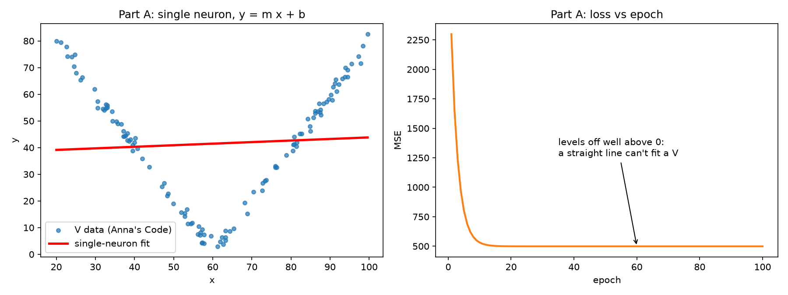
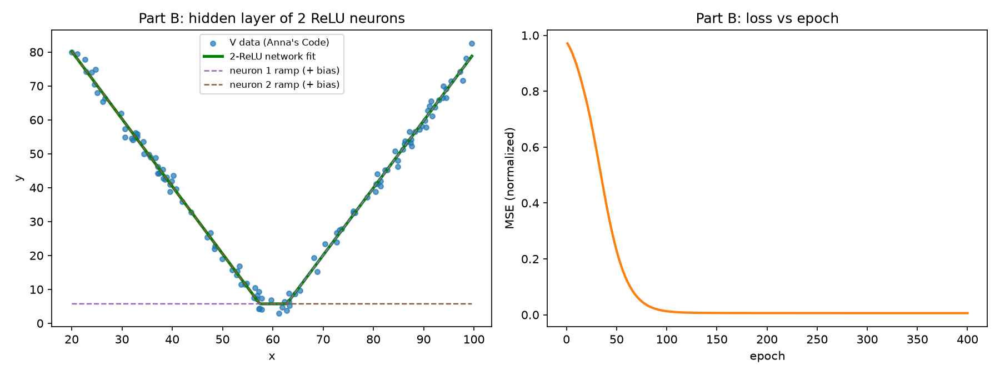

# Part 1: Fitting the V Data with Gradient Descent

Before building the lock, I wanted to understand what a neural network is actually doing when it "learns." I started with the simplest possible case: fitting a curve to data in Anna's Code, then rebuilt the same math by hand in Excel and in Python.

## What is a neuron?

A neuron in a neural network is a tiny function: it takes an input, multiplies it by a **weight**, adds a **bias**, and outputs the result. With one input, that's just the equation of a line:

$$\hat{y} = m x + b$$

Training means finding the weight $m$ and bias $b$ that make the line match the data as closely as possible.

## Exploring in Anna's Code

**Linear data, 1 neuron.** After randomizing the weights and training, the neuron landed on m = [your m] and b = [your b], basically the line the data came from (y = 2x − 100).

[Screenshot: linear fit + loss curve]

**V data, 1 neuron.** A single neuron can only draw a straight line, so the best it can do is a line through the middle of the V. The loss drops at first and then gets stuck.

[Screenshot: V with a single neuron]

**V data, hidden layer of 2 ReLU neurons.** Adding a hidden layer with a ReLU activation lets the line bend, and the network fits the V almost perfectly.

[Screenshot: V with 2 ReLU neurons + loss curve]

My weights: n1 = ReLU([w1] x + [c1]), n2 = ReLU([w2] x + [c2]), output = [v1] n1 + [v2] n2 + [d]

[One or two sentences: which neuron made which arm of the V, and what you noticed when you tried the other data sets (parabola, step, sine, sawtooth) and which activation worked best for each.]

## The Math

### 1. The loss: how wrong is the line?

For every data point, the error is the prediction minus the real value. Squaring makes every error positive and punishes big misses more. Averaging over all $N$ points gives the **mean squared error (MSE)**, which is the loss:

$$L = \frac{1}{N}\sum_{i=1}^{N}(\hat{y}_i - y_i)^2 = \frac{1}{N}\sum_{i=1}^{N}(m x_i + b - y_i)^2$$

### 2. The gradient: which way is downhill?

To lower the loss, we need to know how it changes when we nudge $m$ or $b$. Taking the partial derivatives with the chain rule:

$$\frac{\partial L}{\partial m} = \frac{2}{N}\sum_{i=1}^{N}(\hat{y}_i - y_i)\,x_i \qquad \frac{\partial L}{\partial b} = \frac{2}{N}\sum_{i=1}^{N}(\hat{y}_i - y_i)$$

If $\partial L / \partial m$ is positive, increasing $m$ makes the loss worse, so we should decrease $m$, and the other way around.

### 3. Gradient descent: take a step downhill

Each **epoch**, we move every weight a small step in the opposite direction of its gradient. The step size is the **learning rate** $\alpha$:

$$m \leftarrow m - \alpha\,\frac{\partial L}{\partial m} \qquad b \leftarrow b - \alpha\,\frac{\partial L}{\partial b}$$

Repeat: predict, measure the loss, compute the gradients, update. Every pass is one epoch.

### 4. Why one neuron can't fit a V

No matter what $m$ and $b$ are, $mx + b$ is a straight line. The best straight line through a symmetric V is flat at the average height, so gradient descent converges there and the loss levels off well above zero.

### 5. Adding a ReLU activation layer

ReLU is a simple function that outputs zero for negative inputs and passes positive inputs through unchanged:

$$\text{ReLU}(z) = \max(0, z)$$

This puts a **bend** in the line. With a hidden layer of two ReLU neurons feeding one output neuron:

$$n_1 = \text{ReLU}(w_1 x + c_1) \qquad n_2 = \text{ReLU}(w_2 x + c_2)$$

$$\hat{y} = v_1 n_1 + v_2 n_2 + d$$

Each hidden neuron makes one ramp. The sign of its weight decides which side the ramp is on (positive weight: on to the right; negative weight: on to the left), and the bias decides where it turns on. Adding the two ramps makes a V.

### 6. Backpropagation through ReLU

The gradients come from the same chain rule, just applied through more layers. The only new piece is the slope of ReLU:

$$\text{ReLU}'(z) = \begin{cases} 1 & z > 0 \\ 0 & z \le 0 \end{cases}$$

So for hidden neuron 1, with error $e_i = \hat{y}_i - y_i$ and $z_{1,i} = w_1 x_i + c_1$:

$$\frac{\partial L}{\partial v_1} = \frac{2}{N}\sum e_i\, n_{1,i} \qquad \frac{\partial L}{\partial w_1} = \frac{2}{N}\sum e_i\, v_1\, \text{ReLU}'(z_{1,i})\, x_i \qquad \frac{\partial L}{\partial c_1} = \frac{2}{N}\sum e_i\, v_1\, \text{ReLU}'(z_{1,i})$$

The error flows **backward** from the output, gets multiplied by each layer's slope, and tells every weight how to change. That's backpropagation. One consequence: if a neuron is "off" ($z \le 0$) for every data point, its gradient is always zero and it never learns. That's called a **dead ReLU**.

### A note on normalization

The x values run from 20 to 100, which makes $\partial L/\partial m$ about 60 times bigger than $\partial L/\partial b$, so no single learning rate works well for both. Like Anna's Code does, I normalize x first:

$$u = \frac{x - \bar{x}}{\sigma_x}$$

and fit $\hat{y} = m u + b$. The answer can always be converted back to regular x units afterward.

## Excel: 5 Iterations of Gradient Descent

I took 10 evenly spaced points from my Anna's Code V data and did gradient descent by hand on a single neuron, starting from m = 10, b = 0 with a learning rate of α = 0.1. The spreadsheet shows the first iteration worked out point by point (prediction, error, error², error·u), and then all 5 iterations in a table.

[Embed v_fit.xlsx or a screenshot of the GD single neuron sheet]

| Iteration | m | b | MSE | ∂L/∂m | ∂L/∂b |
|---|---|---|---|---|---|
| 1 | 10.000 | 0.000 | 2285.6 | 17.383 | −83.171 |
| 2 | 8.262 | 8.317 | 1635.8 | 13.906 | −66.537 |
| 3 | 6.871 | 14.971 | 1220.0 | 11.125 | −53.229 |
| 4 | 5.759 | 20.294 | 953.8 | 8.900 | −42.584 |
| 5 | 4.869 | 24.552 | 783.5 | 7.120 | −34.067 |
| after 5 | 4.157 | 27.959 | 674.5 | | |

The loss drops every iteration, but notice where it's heading: **m is shrinking toward 0 and b is climbing toward the average y.** The neuron is turning into a flat line, which is the best a straight line can do on a V.

[Screenshot: the two Excel charts, fit lines and MSE vs iteration]

## Python

The Python script does the same thing in code, in two parts. Code: [GitHub link to part1_v_fit/v_fit.py]

**Part A: single neuron, gradient descent written by hand.** First it reruns the 5 Excel iterations on the same 10 points and prints them. The numbers match the spreadsheet exactly. Then it trains on all 120 points for 100 epochs. The result is y = 0.06x + 37.96, an almost flat line, and the loss levels off at about 500.

**Part B: hidden layer of 2 ReLU neurons, in PyTorch.** Same idea (MSE loss, plain gradient descent), but PyTorch computes the backpropagation for me with `loss.backward()`. After 400 epochs the loss is almost zero, and the weights converted back to x units are:

- n1 = ReLU(0.062x − 3.87), on for x > 62.8: the **right arm**
- n2 = ReLU(−0.061x + 3.52), on for x < 57.4: the **left arm**
- output = 32.21 n1 + 32.44 n2 + 5.73

That makes the arm slopes **+1.98 and −1.99**. The data was generated from y = 2|x − 60|, with slopes of exactly +2 and −2, so the network found the true shape on its own. The small flat spot at the bottom of the fit (between about 57 and 63) is where both neurons are off.

The first two random starts got stuck with a dead ReLU neuron, so the script tries a new random start until one trains properly. That's the same thing as hitting Randomize weights again in Anna's Code.

## What I Learned

- A neural network is just weights and biases being nudged downhill on the loss, one small step at a time.
- One neuron is one straight line. **Depth with an activation function** is what lets a network bend, and **width** (more neurons) gives it more bends to work with.
- Where you start matters: a bad random start can leave a neuron dead, and normalizing the inputs makes the learning rate actually work.
- [Your own takeaway, e.g. something that surprised you in Anna's Code]

This same idea, scaled up to thousands of weights, convolution layers and 6 output classes instead of 1, is what powers the finger-counting model in my lock.
